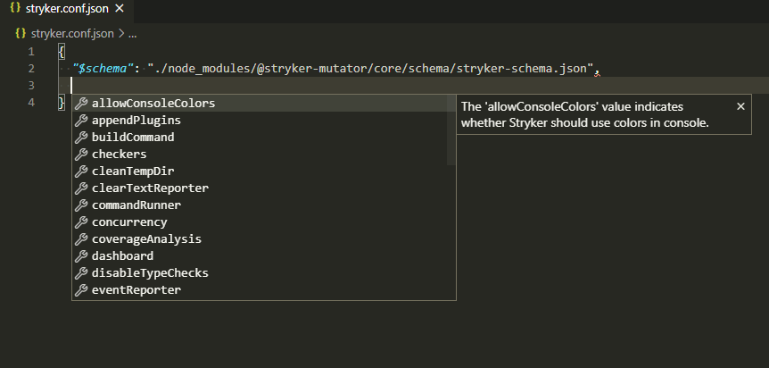

Although a config file is not mandatory, it is recommended. You can define your Stryker configuration in either a JavaScript, TypeScript or JSON file. If you use a JavaScript or TypeScript file, it should export the configuration object. Autocompletion is supported using JSON schema, using [`@type` JS docs](https://jsdoc.app/) or using TypeScript types.

## Configuration options

See [configuration](./configuration.md) for a list of available options.

## Setup

With a `stryker.config.json`:

```json
{
  "$schema": "./node_modules/@stryker-mutator/core/schema/stryker-schema.json",
  "_comment": "Comments can be put inside `xxx_comment` properties."
}
```

Or as `stryker.config.js`:

```js
// @ts-check
/**
 * @type {import('@stryker-mutator/api/core').PartialStrykerOptions}
 */
module.exports = {
  // Your config here
};
```

Since Stryker version 6 you can define your config in a native [ECMAScript module](https://nodejs.org/api/esm.html). Either using the `.mjs` extension, or `.js` if you use `{ "type": module" }` in your `package.json`.

```js
// @ts-check
/** @type {import('@stryker-mutator/api/core').PartialStrykerOptions} */
const config = {
  // Your config here
};
export default config;
```

You can also write your config in TypeScript, as `stryker.config.ts` (or `.mts` / `.cts`). Stryker loads it with Node.js itself, so this needs Node.js 22.18 or newer, which strips the types natively. No extra dependency is needed. Use `import type` for type-only imports, because Node.js only erases types and does not compile TypeScript syntax that has runtime output, like `enum`.

```ts
import type { PartialStrykerOptions } from '@stryker-mutator/api/core';

const config = {
  // Your config here
} satisfies PartialStrykerOptions;
export default config;
```

If Node.js can't import the file, Stryker stops with an error that says so.

You can use your editor's autocompletion to help you author your configuration file.



## Usage

<details>

<summary>History</summary>

| Version | Changes                                                     |
| ------- | ----------------------------------------------------------- |
| 7.1     | Add `.config.{json,js,mjs,cjs}` as default suffix.          |
| 10.2    | Add `.ts`, `.mts` and `.cts` config files (Node.js 22.18+). |

</details>

By default, Stryker will look for a config file in the current working directory. The default config file names are:

- `stryker.conf.{json,js,mjs,cjs,ts,mts,cts}`
- `.stryker.conf.{json,js,mjs,cjs,ts,mts,cts}`
- `stryker.config.{json,js,mjs,cjs,ts,mts,cts}`
- `.stryker.config.{json,js,mjs,cjs,ts,mts,cts}`

You can also use a different configuration file with a second argument to the `run` command.

```shell
# Use default config file names in the current working directory
npx stryker run
# Use "alternative-stryker.config.json"
npx stryker run alternative-stryker.config.json
```

## Glob patterns

Some options allow for a glob pattern to be defined. These glob patterns are defined relative to the cwd.

For example, using `"mutate": [ "src/components/**/*.component.js" ]` will make sure only files ending with ".component.js" in the "src/components" directory are mutated.

We suggest using [https://globster.xyz/](https://globster.xyz/) when auditing more complex glob expressions; it can help you get them just right.

## Example

The following is an example `stryker.config.json` file. It specifies running mocha tests with the mocha test runner.

```json
{
  "$schema": "./node_modules/@stryker-mutator/core/schema/stryker-schema.json",
  "testRunner": "mocha",
  "coverageAnalysis": "perTest"
}
```
